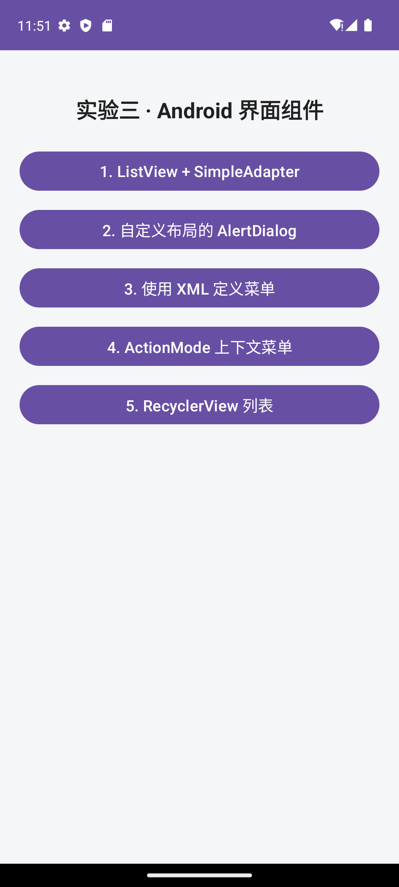
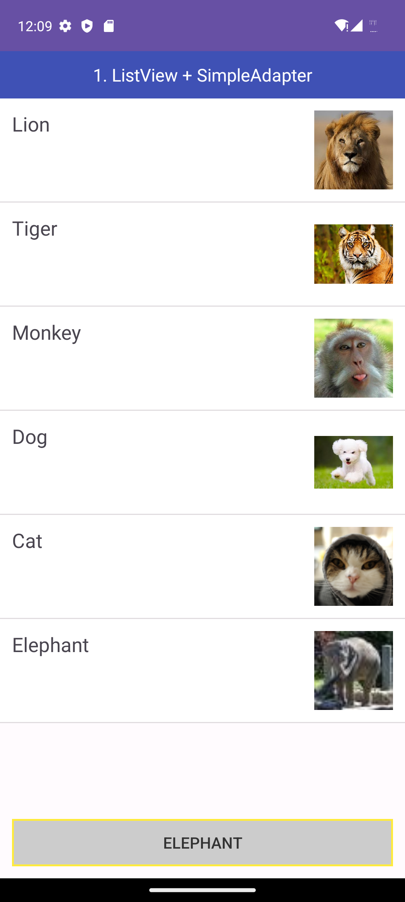
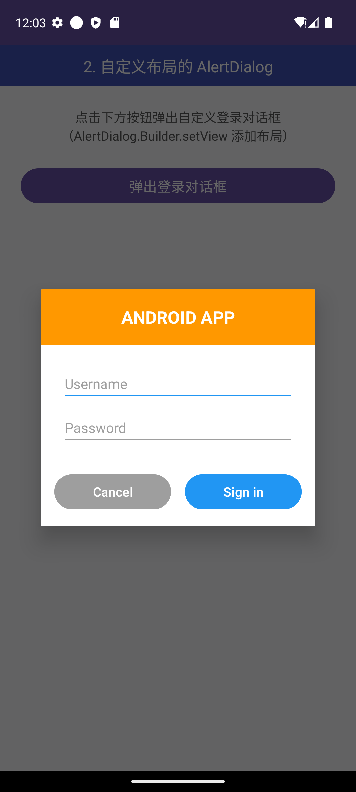
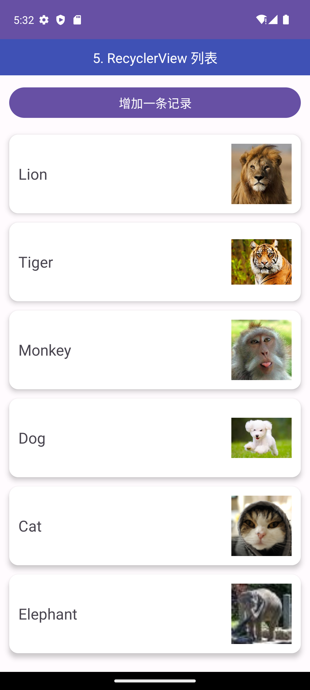
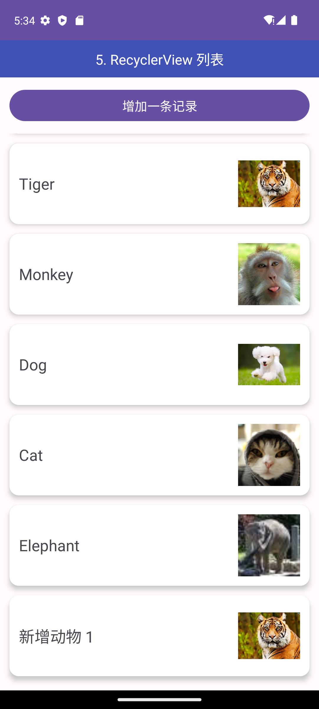

# Experiment03

移动应用开发实验 3：Android 界面组件实验

## 实验目的

1. 掌握 `ListView` 结合 `SimpleAdapter` 实现动物列表界面，列表项包含名称与图片资源。
2. 掌握单击列表项后使用 `Toast` 显示选中信息，并通过 `NotificationManager` 发送通知（图标为应用图标，Title 为列表项内容）。
3. 掌握自定义布局 `AlertDialog` 的实现，通过 `AlertDialog.Builder.setView()` 将自定义登录布局加入对话框。
4. 掌握使用 XML 定义菜单资源，通过选项菜单实现字体大小（小 10 号 / 中 16 号 / 大 20 号字）、普通菜单项（Toast 提示）、字体颜色（红 / 黑）的切换。
5. 掌握 `ListView.CHOICE_MODE_MULTIPLE_MODAL` 结合 `setMultiChoiceModeListener` 创建 ActionMode 上下文操作模式，实现列表项多选、删除。
6. 掌握 `RecyclerView` + 自定义 `Adapter` + `ViewHolder` 实现列表视图，理解 `notifyItemInserted` 局部刷新机制，验证滚动、点击、更新无错位。
7. 自学部分：使用 `CardView`（androidx.cardview 依赖）实现卡片式列表项，掌握 `cardCornerRadius`、`cardElevation` 等卡片属性。

## 实验环境

- 操作系统：Windows 11
- 开发工具：Android Studio（JBR JDK 25）
- 开发语言：Kotlin
- UI 框架：XML 布局 + Material3
- compileSdk：37，minSdk：33，targetSdk：37
- AGP：9.3.0，Gradle：9.5.0
- 模拟器：Pixel 7, API 33

## 项目结构说明

```text
Experiment03
├── app/
│   ├── build.gradle.kts
│   └── src/main/
│       ├── java/com/example/experiment03/
│       │   ├── MainActivity.kt           # 实验导航主页（5 个功能入口）
│       │   ├── ListViewActivity.kt       # 1. ListView + SimpleAdapter
│       │   ├── LoginDialogActivity.kt    # 2. 自定义布局 AlertDialog
│       │   ├── MenuTestActivity.kt       # 3. XML 定义选项菜单
│       │   ├── ActionModeActivity.kt     # 4. ActionMode 上下文操作模式
│       │   └── RecyclerViewActivity.kt   # 5. RecyclerView 列表
│       ├── res/
│       │   ├── layout/                   # activity_main、dialog_login、各页面与列表项布局
│       │   ├── menu/                     # menu_context.xml、action_mode_menu.xml
│       │   ├── drawable/                 # 动物图片资源（lion/tiger/monkey/dog/cat/elephant）
│       │   └── values/                    # strings、colors、themes
│       └── AndroidManifest.xml
├── images/                               # 运行效果图
├── gradle/
├── .gitignore
├── README.md
└── build.gradle.kts
```

## 运行效果图

<p align="center">
  
  
  
  
</p>

<p align="center">
  
  
  
</p>

## 运行步骤

1. 使用 Android Studio 打开本项目 Experiment03。
2. 启动 Pixel 7（API 33）模拟器。
3. 运行配置选择 `app`，点击 Run 编译安装 App。
4. 在导航主页点击 5 个按钮分别进入各实验部分：
   - **第 1 部分**：点击列表项弹出 Toast 并发送通知（首次运行需在系统弹窗中允许通知权限），选中项背景变红；点击底部灰色黄边 "Elephant" 按钮可选中大象。
   - **第 2 部分**：点击"弹出登录对话框"按钮，在 AlertDialog 中输入用户名/密码，点击 Cancel 关闭、Sign in 弹出登录信息 Toast。
   - **第 3 部分**：点右上角 ActionBar 三点菜单按钮弹出选项菜单，选择字体大小（小/中/大）、普通菜单项（Toast）、字体颜色（红/黑），观察测试文本变化。
   - **第 4 部分**：长按列表项进入 ActionMode 多选模式，顶部操作栏显示 "N selected"，点击垃圾桶图标删除选中项。
   - **第 5 部分**：点击列表项弹出 Toast 显示名称；点击"增加一条记录"按钮，列表末尾实时插入新记录。

## 实验总结

本次实验完成 Android 界面组件实验，使用 SimpleAdapter 实现动物列表并配合 Toast 与通知完成交互反馈，掌握了 Android 13+ 通知权限动态申请与通知渠道的创建方式。通过 AlertDialog.Builder.setView() 实现自定义登录对话框，理解对话框与自定义布局结合的写法。使用 XML 菜单资源配合 onCreateOptionsMenu 实现带字体大小与字体颜色子菜单的选项菜单。通过 CHOICE_MODE_MULTIPLE_MODAL 与 MultiChoiceModeListener 实现 ActionMode 多选删除。使用 RecyclerView + Adapter + ViewHolder 完成动物列表，通过 notifyItemInserted 实现局部刷新，理解 RecyclerView 复用机制与 ListView 的区别；自学部分使用 CardView 卡片布局美化列表项。过程中解决了 Material 主题下 Button 的 backgroundTint 覆盖自定义背景、Gradle 配置缓存与 AGP 9.3 兼容导致 processDebugResources 进程崩溃、国内网络无法访问 dl.google.com 需配置阿里云镜像等实际问题。
